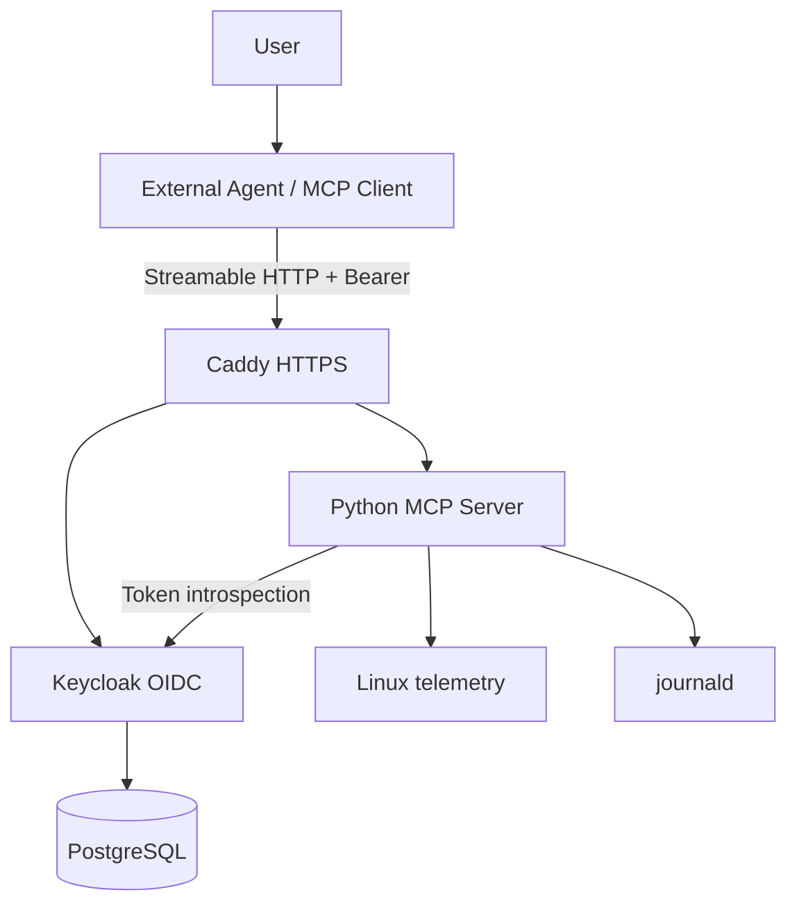

# Architecture and design

> **team-handoff status:** this diagram is the target architecture, not the current deployed state. The branch retains the MCP core and local runtime only. Security, infrastructure and acceptance items are deliberately assigned to members 2 and 3.

## Target topology

## Current application layers

- `config.py`: minimal runtime settings, loopback binding, port validation and disk-path allowlist.
- `system.py`: implemented CPU, memory, disk and process collectors.
- `server.py`: MCP composition, tool/resource/prompt registration and `/healthz`. The `read_allowed_log` handler is a placeholder.
- `__main__.py`: logging setup and Uvicorn entry point.

The files `auth.py`, `auth_claims.py`, `log_reader.py`, Caddyfile, Compose model, systemd unit and production environment template are intentionally absent on this branch.

## Target responsibilities

- MCP Client: initialization, capability discovery, tool invocation and OAuth client flow.
- MCP core: protocol handling, argument validation and read-only telemetry.
- Member 2: Keycloak/OAuth, journald access, Caddy, Compose, systemd and Linux privilege controls.
- Member 3: real HTTP/client tests, security regression tests, deployment acceptance, benchmarks and evidence.
- Group leader: architecture, OOAD, MCP core, review and final integration.

## Target security design

The intended production design uses Keycloak as authorization server, the MCP app as resource server, Caddy as the only LAN ingress and a dedicated non-root systemd service. It requires `mcp.read` for MCP access and `mcp.logs.read` for journald. This behavior is not implemented on this branch. The app must remain loopback-only.

See `docs/10_team_workstream_handoff.md` for detailed ownership and acceptance criteria.
