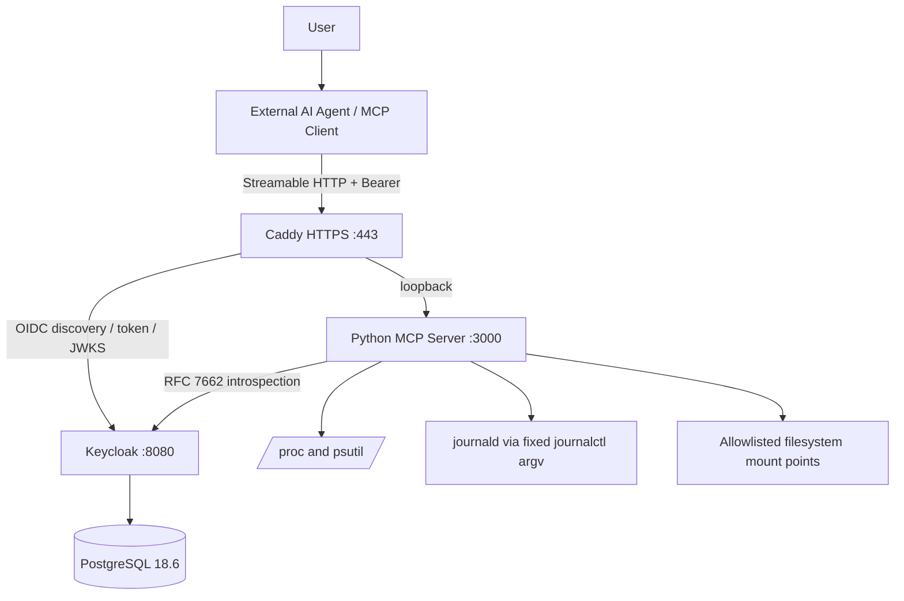

# Architecture and design

## Runtime topology

## Responsibilities

- Agent/Host: natural-language understanding, model selection and inference, tool choice, result presentation.
- MCP Client: MCP initialization, list tools/resources/prompts, invoke tools, OAuth client flow.
- Caddy: TLS, host routing and strict route allowlist. Only port 443 is exposed to the LAN.
- Keycloak: authorization server; creates and signs tokens. The MCP service never issues tokens.
- MCP application: verifies each bearer token through Keycloak introspection, confirms exact issuer/expiry/audience/resource/scope, and invokes read-only Linux functions.
- Linux: source of CPU/RAM, filesystem, process and journal data.
- PostgreSQL: Keycloak persistence only.

## Python application layers

- `config.py`: typed environment configuration, loopback-only backend guard.
- `auth.py` + `auth_claims.py`: RFC 7662 introspection adapter and fail-closed claim validation.
- `system.py`: psutil-based system/disk/process metrics.
- `log_reader.py`: alias allowlist and bounded `journalctl` execution.
- `server.py`: MCP Tools, Resource, Prompt and ASGI composition.
- `__main__.py`: Uvicorn process entry point.

Synchronous OS handlers run in the MCP SDK's worker thread. The log reader always uses an argv array with `shell=False`, fixed executable, timeout and output limits.

## Transport and routes

- MCP: `https://mcp.home.arpa/mcp`.
- MCP protected resource metadata: `/.well-known/oauth-protected-resource/mcp`.
- Health: `/healthz`, separate unauthenticated health route; backend is loopback-only.
- Authorization server: `https://auth.home.arpa/realms/linux-agent`.
- MCP process binds `127.0.0.1:3000`; Keycloak binds `127.0.0.1:8080`; PostgreSQL is internal to Docker network.

## Authorization

The SDK applies the base `mcp.read` scope to the MCP resource server. The token verifier additionally checks that `aud` contains the exact canonical resource URI. The log tool enforces `mcp.logs.read` before executing `journalctl`. The client credentials flow must request both the appropriate scope and `resource=https://mcp.home.arpa/mcp`.

Keycloak Resource Indicators is experimental in the pinned Keycloak release. Do not open the LAN route until token issuance and introspection integration tests confirm audience binding.
