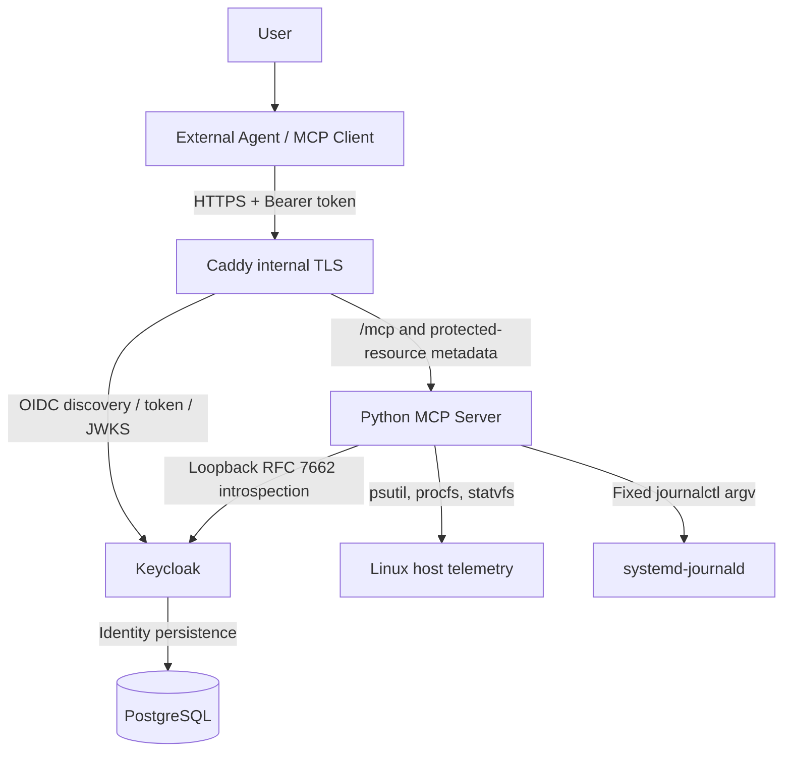

# Architecture and design

## System context

The product is a read-only Linux observability MCP resource server. Model inference and Agent orchestration are intentionally outside the system boundary.

## Deployment topology

## Runtime components

| Component | Runtime | Responsibility |
|---|---|---|
| MCP application | Native Python process under systemd | MCP tools/resources/prompts, request authorization, telemetry |
| Caddy | Docker Compose, host network | Internal TLS, exact host/path routing, only intended LAN ingress |
| Keycloak | Docker Compose, private identity network + loopback port | OIDC discovery, token issuance, RFC 7662 introspection |
| PostgreSQL | Docker Compose, internal identity network | Keycloak persistence only |

The MCP application is not containerized. The Compose stack does not contain an application database.

## Application modules

- `config.py`: environment parsing, production-mode checks, loopback binding, canonical resource/audience and bounded journal settings.
- `server.py`: MCP server composition, Tools, Resource, Prompt, protected-resource metadata, ASGI lifespan and `/healthz`.
- `system.py`: read-only CPU, memory, disk, process and system-summary collectors.
- `auth.py`: async adapter to Keycloak RFC 7662 introspection.
- `auth_claims.py`: pure fail-closed validation of introspection claims.
- `log_reader.py`: alias allowlist, bounded journalctl process execution, JSON parsing and best-effort redaction.
- `__main__.py`: logging setup and Uvicorn entry point.

## Request flow

1. The external MCP Client obtains an access token from Keycloak using the separately configured client flow.
2. The client connects to Caddy over HTTPS and sends the MCP request with a bearer token.
3. Caddy validates the host and path through its route allowlists and forwards the request to the loopback MCP listener.
4. The MCP SDK invokes the configured token verifier. The application introspects the token through Keycloak's loopback-only endpoint and validates active state, issuer, expiry, resource/audience and `mcp.read`.
5. For `read_allowed_log`, the handler additionally requires `mcp.logs.read` before launching journalctl.
6. The selected read-only collector returns bounded structured data. No metrics are written to PostgreSQL or forwarded to an LLM.

## Trust boundaries and network exposure

- Caddy is the only intended LAN-facing service and uses an internal CA.
- MCP listens on `127.0.0.1:3000`; Keycloak's application listener is published only at `127.0.0.1:8080`.
- PostgreSQL is on an internal Docker network and has no published host port.
- Keycloak administration is available only from loopback. LAN routes expose only the configured OIDC discovery, token and signing-key endpoints.
- The introspection endpoint is private to the MCP host and is not published through Caddy.
- The Caddy CA root certificate may be installed in client trust stores. Its private key must never be distributed.

## Core design constraints

- Client input may select a documented tool option or an allowlisted alias, but never an executable, arbitrary filesystem path or systemd unit.
- Telemetry functions remain independent of MCP and Keycloak classes.
- Process results exclude command lines, environment variables and usernames.
- Journal output is untrusted, bounded and redacted on a best-effort basis.
- MCP Tool metadata can communicate read-only intent to clients but is not a security boundary; enforcement remains server-side.

## Availability and lifecycle

The Starlette host application owns the MCP session-manager lifespan because mounting the SDK's Streamable HTTP app disables its own lifespan. The operational `/healthz` route is registered outside the MCP bearer-auth sub-application. Caddy does not publish `/healthz` to the LAN.
