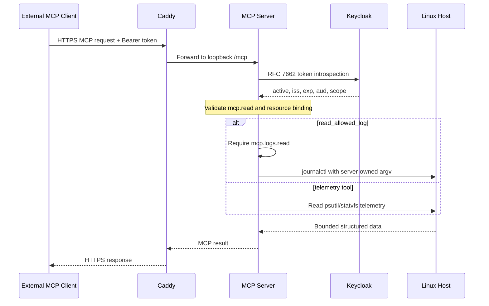
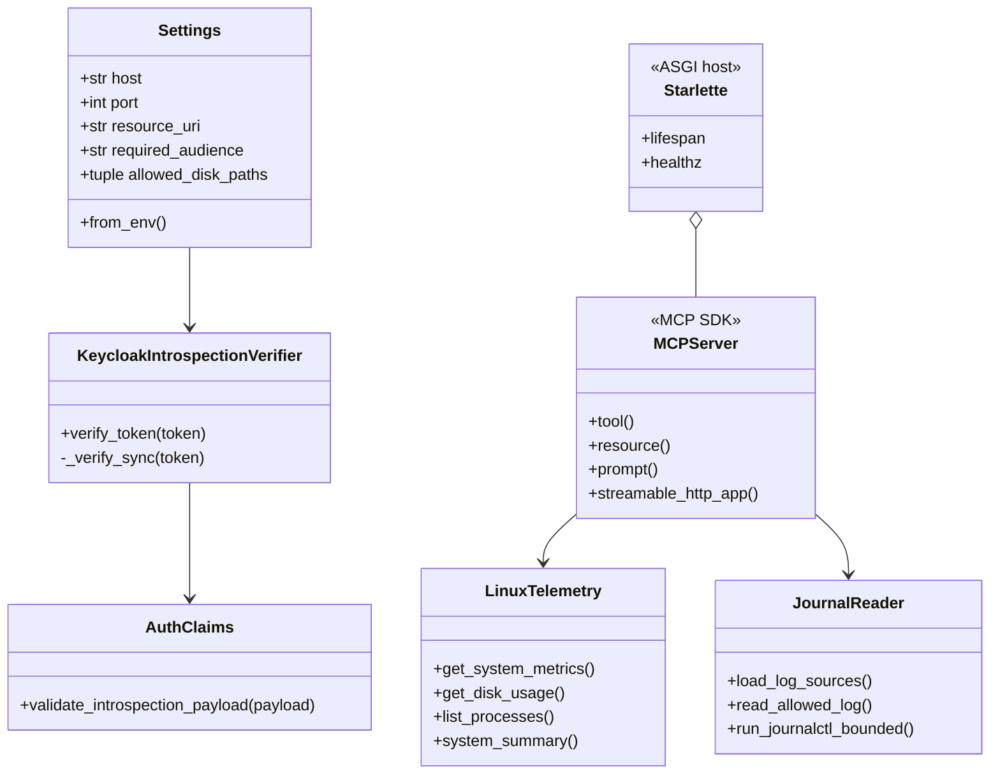

# OOAD analysis and UML

## Design overview

The application separates MCP protocol composition, environment configuration, identity validation, journal access and Linux telemetry. Infrastructure services are deployed independently from the Python MCP process.

## Module responsibilities

| Module | Responsibility |
|---|---|
| `config.py` | Immutable environment settings, URL/resource validation, loopback constraints and execution bounds |
| `server.py` | MCP composition, Tools, Resource, Prompt, auth wiring and ASGI lifecycle |
| `system.py` | CPU, memory, load, uptime, disk, process and host-summary collectors |
| `auth.py` | Async token-verifier adapter for Keycloak introspection |
| `auth_claims.py` | Pure validation of introspection claims |
| `log_reader.py` | Alias mapping, fixed journalctl arguments, time/output caps and redaction |
| `__main__.py` | Logging and Uvicorn startup |

## Main runtime sequence

## Class/module view

## Security and object constraints

- The configuration object is immutable after construction.
- Token validation rejects malformed or non-finite NumericDate claims rather than allowing them to raise during request authentication.
- Process identity is checked using PID plus creation time to avoid mixing samples after PID reuse.
- Journal aliases map to configured `.service` units; caller input is never interpolated into a shell command.
- The journal reader uses `shell=False`, bounded lines, execution timeout, byte limit and best-effort redaction.
- PostgreSQL belongs to the Keycloak persistence boundary, not the application data model.
