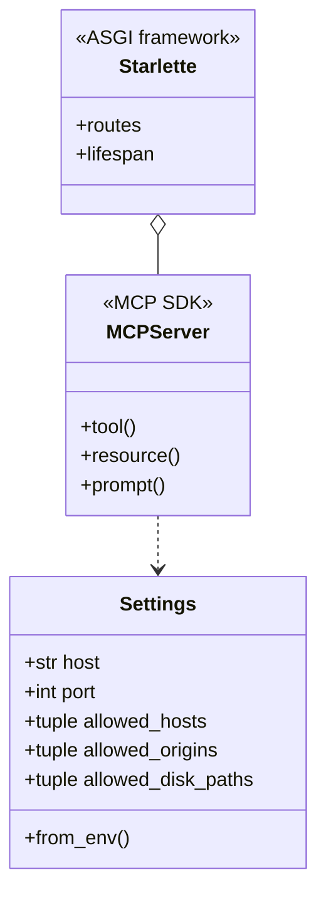

# OOAD analysis and UML

> This describes the current `team-handoff` branch. Security and deployment implementation has been returned to member 2.

## Current modules

| Module | Responsibility |
|---|---|
| `config.py` | Minimal local runtime configuration and loopback/path constraints |
| `server.py` | MCP composition, tools, resource, prompt and health route |
| `system.py` | CPU, memory, disk and process telemetry |
| `__main__.py` | Logging and Uvicorn entry point |

The modules `auth.py`, `auth_claims.py` and `log_reader.py` are intentionally absent. Member 2 implements them and integrates the results into `server.py`.

## Design principles

- Separate MCP registration, runtime configuration and Linux telemetry.
- Keep telemetry functions independent from MCP protocol classes.
- Restrict caller-supplied disk paths to the administrator allowlist.
- Bound process sampling and treat collected data as untrusted output.

## Use cases

**UC-01 — Host overview:** the client invokes `get_system_metrics`, `get_disk_usage` and `list_processes`; the server returns structured measurements for the Agent to summarize.

**UC-02 — Journal access (pending):** `read_allowed_log` remains discoverable but returns `NOT_IMPLEMENTED`. No journal command runs on this branch. Member 2 owns the alias allowlist, bounded reader and authorization; member 3 owns independent regression tests.

**UC-03 — Context:** the client reads `linux://system/summary` and may retrieve the `health_check` prompt.

## Current composition

## Traceability

- System telemetry FRs are implemented in `system.py`.
- MCP composition, resource, prompt and `/healthz` are in `server.py`.
- Journald and OAuth requirements remain pending.
- The in-process SDK Client test is not proof of real HTTP, TLS, LAN or production authorization acceptance.
