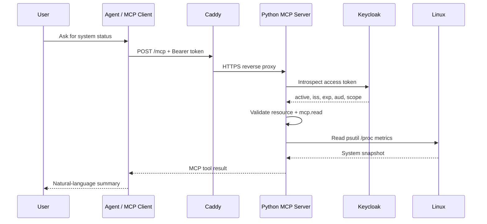
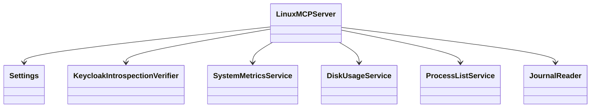

# OOAD analysis and UML

## Domain objects

- `Settings`: immutable runtime configuration and security invariants.
- `KeycloakIntrospectionVerifier`: validates bearer tokens with the authorization server.
- `SystemMetricsService`: CPU/RAM/load/uptime snapshot.
- `DiskUsageService`: exact-path allowlist and filesystem statistics.
- `ProcessListService`: bounded process sampling and percentage semantics.
- `JournalReader`: alias-to-unit mapping, fixed argv, timeout and redaction.
- `LinuxMCPServer`: registers tools, resource and prompt.

## Design principles

Single responsibility is applied at module boundaries. The MCP adapter does not contain OS collection logic. System functions do not know about OAuth or MCP. The log reader never accepts a unit or command from the client. Authentication is checked before MCP handlers execute; the higher-privilege log operation has an additional scope check.

## Sequence: tool call

## Class diagram

